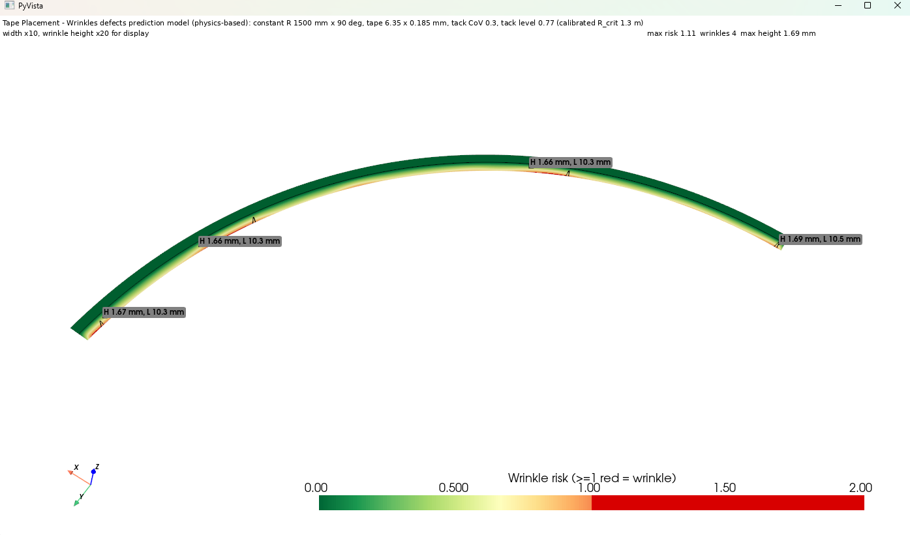
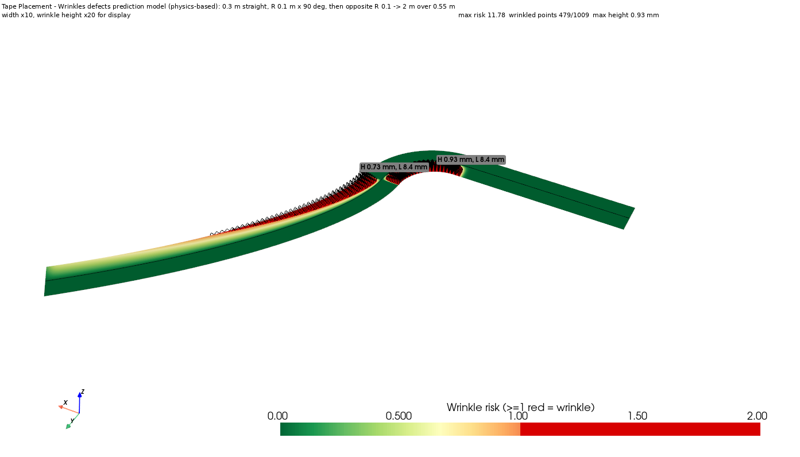

# AFP Wrinkle Predictor

Physics-based wrinkle prediction for steered prepreg tape in Automated Fibre
Placement (AFP). Given a 3D tow path (straight, constant-radius, or
variable-radius steering), the script evaluates a buckling-on-tack-foundation
criterion, combined with a tack-peel criterion, at every point across the
tape width, and reports where and how wrinkles are expected to form.

Implementation: `wrinkle_predictor.py`.

## Example output




## Criterion

```
wrinkle  <=>  compressive strain  -eps(s, y)  >=  eps_crit(s)
eps_crit = max(eps_bif, eps_Gamma)      evaluated just behind the roller
                                        ("immediate") and after tack
                                        relaxation ("delayed")

eps_bif   = 2*sqrt(D_eff*K) / (E1*h)        buckling on the tack foundation
eps_Gamma = sqrt(2*Gamma / (E1*h))          energy to peel the tape off
```

Wrinkle geometry (post-buckling estimate):

```
length    L   = 2*pi*(D_eff/K)^(1/4)                     buckling wavelength
spacing   gap = -l*ln(1 - eps_crit/eps),  l = sqrt(E1*h/k_s)
          (after a wrinkle, the compression rebuilds through the tack by shear lag)
height    H   = (2/pi)*sqrt(L*dL),  dL = tape length released into one wrinkle
```

Model chain: geometry -> fibre strain from the 3D tape surface -> roller
contact (Winkler layer) -> nip temperature / cooling (hot-gas convection) ->
tack (intimate contact, healing, tack energy, foundation stiffness) -> risk
and geometry per point.

Default material/tack values are **placeholders** (CYCOM 977-2 order of
magnitude, partly from the Kheradpisheh PhD thesis below). Calibrate them
with probe-tack, relaxation and viscosity tests before quantitative use.

## Usage

```
pip install -r requirements.txt
python wrinkle_predictor.py
```

All settings are hard-coded: edit the run settings and `PARAMS` in
`wrinkle_predictor.py`. `RUN` selects the case: `"s_course"`, `"arc_1500"`
or `"sensitivity"` (heating x speed study).

Path CSV columns: `x, y, z` (`PATH_UNITS`), optional `nx, ny, nz` (surface
normal), optional per-point process columns: `speed_mm_s, force_N, T_nip_C,
T_gas_C, tension_N`.

## Model origins: what comes from the thesis, what was added

Reference: M. Kheradpisheh, *Prediction of In-Plane and Out-of-Plane Defects
in Steered Prepreg Tape during AFP*, PhD thesis, Concordia University, 2025.

### 1. Taken from the thesis

| Item | Thesis source | How it is used in the script |
|---|---|---|
| Wrinkle = buckling of the tape on a "tack foundation", driven by the inner-edge compression from the length mismatch when steering | Ch. 2.3, 3.4, 5.4 | Base principle of the criterion |
| Load varies linearly across the width: compression at the inner edge, tension at the outer edge; the neutral axis position matters | Eq. 6, 59–60; Ch. 7.3 | Recovered by the kinematic strain field; unstrained-fibre offset kept as an option |
| Critical load of a fibre on a foundation, P = EI·λ² + K/λ² | Eq. 58 | Minimised → `eps_bif = 2·sqrt(D_eff·K)/(E1·h)` and wavelength `2π·(D_eff/K)^¼` |
| Tack as a viscoelastic foundation (generalized Maxwell model, Prony series) | Ch. 4.3.1, 5.4.1 | `K(t)` relaxation |
| Relaxation shape of Kz(t): K∞/K₀ ≈ 0.34, τ ≈ 43.5 s | Eq. 61 | `prony_inf_frac`, `prony_terms` (the absolute value isn't transferable, only the shape) |
| Upper critical load (just after placement) and lower critical load (after relaxation) | §5.6.1 | "immediate" and "delayed" checks |
| Material and process values: E₁ = 31 GPa, width 6.35 mm, thickness 0.17 mm, 250 N, 160 °C hot gas, 76 mm/s, tool at 23 °C, polyurethane roller Ø38 mm | Tables 3.1, 3.5.1, 5.1; §5.3.1 | Defaults in `PARAMS` |
| Roller contact length ≈ 8 mm (polyurethane) and 1.5 mm (steel); dwell time = contact length / feed rate | Ch. 6.3.1, 6.4.2; Eq. 65 | Used to set the roller stiffness; dwell time formula |
| Tack is highest around 45 °C | §5.5.1, Ch. 6.3 (from Budelmann et al.) | Reference temperature and target of the tack-energy peak |
| Pressure, temperature and dwell time act together on bonding (qualitative) | Ch. 6.4, 6.7 | Motivates the process → tack chain |
| Validation data: wrinkle wavelengths 6–9 mm; fewer wrinkles at larger radius | Tables 3.2, 5.2 | Checks: the model gives 8–10 mm, and the spacing law reproduces the trend |
| Initial imperfections lower the critical load (Koiter model) | Ch. 3.4.2 | Concept only; represented by the tack variability field |

**Not used:** the Ch. 3 plate model (Galerkin + finite differences), the Ch. 4
3D-elasticity solution, the Ch. 6 cohesive-zone FE model, the Ch. 7
concave-roller design, and the fitted β = 1.2 of Eq. 59.

### 2. Added in this work (not in the thesis)

The physics in this table comes from well-known references outside the thesis.

| Item | Physics / reference | Purpose |
|---|---|---|
| Fibre strain computed from 3D path points and surface normals | Kinematics of offset fibres, `\|c' + y·d'\|` | Replaces `P₀ = βE₁hb/R`; handles any path (in-plane curvature, twist, variable radius) |
| Force balance across the width, plus optional tow tension | Statics | Positions the unstrained fibre |
| Roller contact: contact length, pressure, dwell time | Elastic (Winkler) layer roller | Compaction force → pressure and time |
| Nip temperature from hot gas; cooling into the tool | Convective heating of the tape, exponential cooling | Heating settings → temperature |
| Viscosity η(T) and time–temperature shift of K(t) | Arrhenius law, reduced time | Temperature effect on flow and on tack relaxation |
| Degree of intimate contact D_ic | Lee–Springer model | Pressure × time / viscosity → contact quality |
| Healing D_h ∝ (t/t_h)^¼ | Autohesion (Wool type) | Effect of dwell time |
| Tack energy Γ = D_ic·D_h·Γ₀·(1 + φ(a_T·v)) | Gent–Schultz viscoelastic adhesion | Rate and temperature dependence; produces the tack optimum |
| Peel criterion `eps_Gamma = sqrt(2Γ/(E₁h))`, combined as `eps_crit = max(eps_bif, eps_Gamma)` | Thin-film buckling-driven debonding (Hutchinson–Suo) | A wrinkle must also break the tack |
| Risk index per point and per fibre; wrinkle width across the tape; minimum steerable radius | — | Point-by-point output along the path |
| Wrinkle height `H = (2/π)·sqrt(L·ΔL)` | Post-buckling of inextensible fibres, raised-cosine shape, clamped-strip strain | Height estimate |
| Wrinkle spacing `gap = −ℓ·ln(1 − eps_crit/eps)`, ℓ = sqrt(E₁h/k_s), placed by stepping along the path | Shear-lag stress recovery | Spaced wrinkles; fewer at larger radius |
| Spatial tack variability (lognormal field) and one-point tack-level calibration | Statistics, calibration | Spaced wrinkle areas on a constant radius |
| Built-in cases (S course, 1500 mm arc), heating × speed sensitivity study, PyVista and matplotlib views | — | Testing and visualisation |

### 3. Status of the numerical values

Only the values in §1 come from the thesis. All other parameters are
**placeholders chosen by us**: η_ref, E_a, D₀, C_ic, t_heal, Γ₀, φ, k_ref =
1e10 Pa/m (chosen to reproduce the thesis wavelengths), k_shear, heat
transfer coefficients, variability CoV, and the 1.3 m calibration target.
They must be measured before quantitative use: probe tack, relaxation,
viscosity, in-plane shear, and steering trials.

See [MODEL_ORIGINS.md](MODEL_ORIGINS.md) for this same breakdown.
